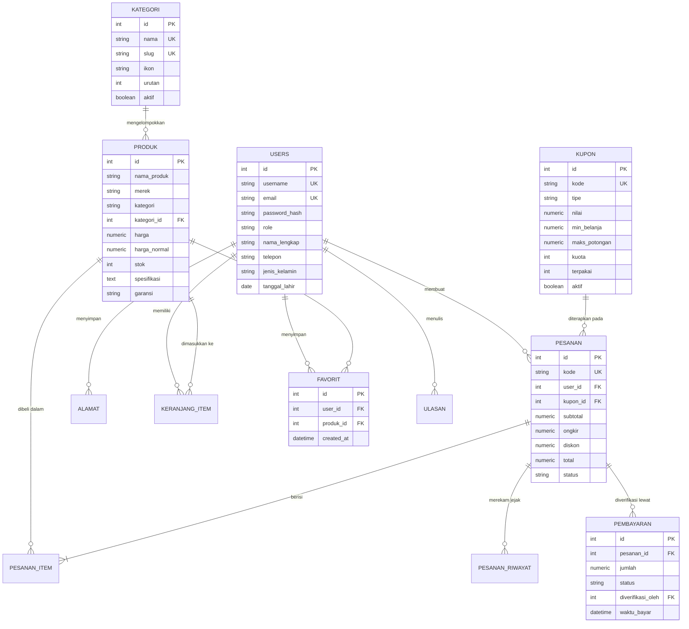

# Dokumentasi Arsitektur Database & ERD E-Commerce
Disusun oleh: **Pedro Juanda Sebayang** (Backend Engineer)
Proyek: PBL Rekayasa Keamanan Siber (RKS 323), Politeknik Negeri Batam

---

## 1. Ringkasan Desain Skema Basis Data

Aplikasi web e-commerce Elektronik Store menggunakan arsitektur relasional berbasis **SQLAlchemy ORM** dan **Flask-Migrate (Alembic)** yang dinormalisasi ke Third Normal Form (3NF).

### Entitas Utama dan Kardinalitas:
1. **`users`** (1:N ke `pesanan`, `alamat`, `keranjang_item`, `ulasan`, `favorit`, `kode_otp`)
   - Menyimpan kredensial otentikasi (argon2 hash), role RBAC (`admin`, `staf`, `pelanggan`), counter gagal login, dan token rotasi sesi.
2. **`kategori`** (1:N ke `produk`)
   - Normalisasi katalog untuk mengelompokkan barang belanjaan berdasarkan jenis perangkat (Handphone, Laptop, Smartwatch, Tablet, Audio, Aksesoris).
3. **`produk`** (N:1 ke `kategori`, 1:N ke `pesanan_item`, `keranjang_item`, `ulasan`, `favorit`)
   - Menyimpan spesifikasi teknis terstruktur, histori harga promo/normal, persentase diskon, dan batas stok menipis.
4. **`pesanan`** (N:1 ke `users`, N:1 ke `kupon`, 1:N ke `pesanan_item`, `pesanan_riwayat`, 1:N ke `pembayaran`)
   - Transaksi pemesanan dengan snapshot alamat, status alur pesanan, subtotal, ongkir flat, dan potongan diskon kupon.
5. **`kupon`** (1:N ke `pesanan`)
   - Manajemen kode voucher promosi diskon (tipe persentase maupun nominal), batas minimum belanja, kuota kupon, dan masa berlaku.
6. **`favorit`** (Wishlist - relasi N:M antara `users` dan `produk`)
   - Dilengkapi *unique constraint* composite `(user_id, produk_id)` untuk mencegah redundansi wishlist.
7. **`pembayaran`** (N:1 ke `pesanan`, N:1 ke `users` sebagai verifikator)
   - Audit trail transaksi pembayaran, bukti transfer bank, status verifikasi (`pending`, `diverifikasi`, `ditolak`), dan pencatatan staf verifikator.

---

## 2. Diagram Hubungan Entitas (ERD)

---

## 3. Strategi Indexing & Integritas Referensial
- **Indeks Unik**: `users.username`, `users.email`, `kategori.slug`, `kupon.kode`, `pesanan.kode`.
- **Indeks Pencarian**: `produk.kategori_id`, `pesanan.user_id`, `pesanan.status`, `favorit.user_id`, `pembayaran.status`.
- **Integritas Cascade**:
  - `ON DELETE CASCADE`: menghapus `keranjang_item` dan `favorit` saat pengguna atau produk dihapus.
  - `ON DELETE SET NULL`: menjaga riwayat pemesanan tetap utuh (`kupon_id` dan `kategori_id`) meskipun master kupon atau kategori diarsipkan.
