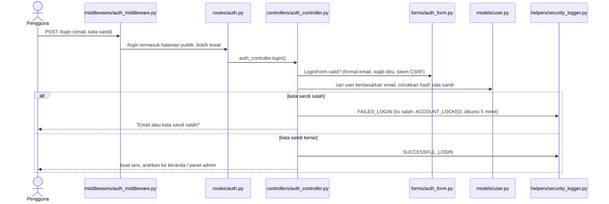
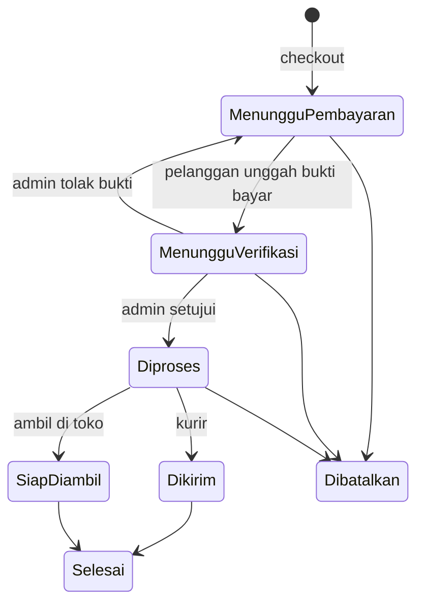

# Panduan Memahami Kode

Panduan ini untuk seluruh anggota tim, agar setiap orang paham **gambaran besar** aplikasi dan
**bagian yang dipegangnya**, serta siap menjawab pertanyaan saat demo ATS/AAS.

Isi:
1. [Gambaran besar (analogi restoran)](#1-gambaran-besar-analogi-restoran)
2. [Satu alur lengkap: menekan tombol "Masuk"](#2-satu-alur-lengkap-menekan-tombol-masuk)
3. [Peta folder dan file penting](#3-peta-folder-dan-file-penting)
4. [File wajib dibaca per anggota](#4-file-wajib-dibaca-per-anggota)
5. [Pertanyaan yang mungkin ditanya dosen (+ jawaban)](#5-pertanyaan-yang-mungkin-ditanya-dosen--jawaban)
6. [Urutan demo ATS (10 menit)](#6-urutan-demo-ats-10-menit)
7. [Latihan singkat untuk memahami kode](#7-latihan-singkat-untuk-memahami-kode)
8. [Lampiran: daftar halaman](#lampiran-daftar-halaman)

---

## 1. Gambaran besar (analogi restoran)

Aplikasi ini memakai pola **MVC** (Model - View - Controller) dengan **Blueprint** Flask.
Bayangkan sebuah restoran:

| Folder | Di restoran | Tugasnya di aplikasi |
|---|---|---|
| `routes/` | **Pelayan** | Menerima pesanan (URL) dan meneruskan ke koki yang tepat. Satu file = satu Blueprint |
| `controllers/` | **Koki** | Mengerjakan pesanan: logika tiap fitur |
| `forms/` | **Pemeriksa pesanan** | Validasi input di server (email valid? kata sandi cukup kuat?) |
| `models/` | **Gudang bahan** | Tabel database sebagai class Python (User, Produk, Pesanan, ...) |
| `templates/` + `static/` | **Penyajian di piring** | Halaman HTML (Jinja2), JavaScript, gambar |
| `middlewares/` | **Satpam pintu** | Sudah login? Boleh masuk area admin? (RBAC) |
| `helpers/` | **Alat dapur** | Upload gambar aman, log keamanan, email, format waktu |
| `migrations/` | **Catatan renovasi gudang** | Riwayat perubahan struktur tabel database |
| `tests/` | **Pencicip** | Pengujian otomatis (pytest) agar fitur lama tidak rusak |

Pola setiap fitur selalu sama: **pelayan → pemeriksa → koki → gudang → piring**.

## 2. Satu alur lengkap: menekan tombol "Masuk"



Langkah demi langkah:

1. **Middleware** (`middlewares/auth_middleware.py`) berjalan sebelum setiap request. Halaman `/login`
   ada di daftar `PUBLIC_ENDPOINTS`, jadi boleh dibuka tanpa login. Halaman lain otomatis wajib login
   (*default deny*).
2. **Route** (`routes/auth.py`): URL `/login` milik Blueprint `auth`, diteruskan ke
   `auth_controller.login()`.
3. **Form** (`forms/auth_form.py`, class `LoginForm`): memeriksa format email, field wajib, dan token
   CSRF. Spasi di awal/akhir email dibuang otomatis (`rapikan_email`).
4. **Controller** (`controllers/auth_controller.py`, fungsi `login`): mencari user lewat model, lalu
   `user.check_password(...)` mencocokkan kata sandi dengan **hash** di database.
5. **Model** (`models/user.py`, class `User`): kata sandi tidak pernah disimpan asli, hanya hash-nya
   (`set_password` / `check_password`). Method `register_failed_login` mengunci akun setelah 5x gagal.
6. **Log** (`helpers/security_logger.py`, fungsi `log_event`): setiap kejadian ditulis ke
   `logs/security.log`, satu baris per kejadian, untuk dibaca Wazuh:
   ```
   2026-10-19T14:30:00+07:00 | WARNING | FAILED_LOGIN | src_ip=192.168.66.5 | email=x@y.com | reason=invalid_password
   ```
7. **Template** (`templates/auth/login.html`): ditampilkan lagi dengan pesan error, atau pengguna
   diarahkan ke halaman berikutnya.

## 3. Peta folder dan file penting

| Lokasi | Isi penting |
|---|---|
| `app.py` | `create_app()`: menyalakan database, CSRF, logger, middleware, mendaftarkan Blueprint, header keamanan |
| `config.py` | Semua pengaturan dari file `.env` (database, batas login, OTP, email, Google) |
| `routes/__init__.py` | Daftar 5 Blueprint dan fungsi `register_blueprints(app)` |
| `routes/toko.py` | Beranda, jelajah, detail produk, ulasan |
| `routes/auth.py` | Daftar, masuk/keluar, OTP email, lupa kata sandi, login Google |
| `routes/belanja.py` | Keranjang, checkout, pesanan pelanggan |
| `routes/akun.py` | Profil, pengaturan akun, alamat |
| `routes/admin.py` | Panel `/admin`: produk, pesanan, ulasan, laporan, pengguna |
| `models/user.py` | Class `User`, tabel izin peran `IZIN` (RBAC), hash kata sandi, penguncian akun |
| `models/produk.py` | Class `Produk`, daftar merek & kategori, diskon, spesifikasi |
| `models/pesanan.py` | Class `Pesanan`, alur status pesanan (`TRANSISI`) |
| `middlewares/auth_middleware.py` | Cek login global, `izin_required(...)` untuk izin per fitur |
| `helpers/image_security.py` | Validasi upload gambar (ukuran, isi biner, nama acak) |
| `helpers/security_logger.py` | Log keamanan untuk Wazuh |
| `templates/layouts/` | Kerangka halaman toko dan panel admin |
| `templates/_macros.html`, `templates/_produk.html` | Komponen yang dipakai ulang (field form, kartu produk) |
| `static/js/app.js` | JavaScript (carousel, tab, tombol jumlah). Tidak ada script inline karena CSP |
| `migrations/versions/` | 8 file migrasi, berurutan dari tabel pertama sampai kolom spesifikasi |
| `tests/` | 166 tes; `tests/conftest.py` menyiapkan aplikasi uji dengan database sementara |
| `docs/KEAMANAN.md` | Daftar kontrol keamanan dan semua jenis event log |

Alur status pesanan (`models/pesanan.py`):



Perpindahan status di luar diagram ini ditolak server, walaupun request-nya dimanipulasi.
Stok dipotong saat checkout dan dikembalikan jika pesanan batal. Pesanan yang belum dibayar dalam
24 jam (`BATAS_BAYAR_JAM` di `config.py`) otomatis dibatalkan.

## 4. File wajib dibaca per anggota

Tidak perlu membaca semua file. Cukup pahami bagian sendiri dan alur login di atas.

**Intan - Desain UI/UX**
- `templates/layouts/toko.html` - kerangka halaman toko (header, menu, footer)
- `templates/_produk.html` - kartu produk; `templates/toko/detail.html` - halaman detail produk
- `static/js/app.js` - interaksi (carousel, tab)
- `frontend/` - prototipe UI dari Figma (asal fitur detail produk)
- Konsep: ``, ``, macro, `url_for(...)`, Tailwind CSS

**Yudha - Ketua tim, Frontend, Infrastruktur**
- `routes/__init__.py` dan satu file Blueprint (mis. `routes/toko.py`)
- `templates/layouts/toko.html` dan `templates/layouts/admin.html`
- `deploy/` dan `docs/DEPLOY.md` - Nginx, systemd, HTTPS di server
- `app.py` fungsi `security_headers` - header keamanan (CSP, HSTS, X-Frame-Options)
- Format log di `docs/KEAMANAN.md` - untuk rule Wazuh di `infrastructure/`

**Pedro - Backend**
- `app.py`, `config.py`, semua `routes/`, `controllers/`, `models/`, `migrations/`
- `middlewares/auth_middleware.py` - autentikasi dan RBAC

**Pasha - Quality Assurance**
- `tests/conftest.py` - cara aplikasi uji disiapkan (database sementara, 2 akun awal)
- `tests/test_auth.py`, `tests/test_blueprint.py`, `tests/test_detail_produk.py` - contoh tes
- Menjalankan tes: `pytest -q` (semua harus "passed"), satu file: `pytest tests/test_auth.py -v`

**Ihsan - Fitur tambahan & kualitas/keamanan**
- `helpers/image_security.py` - upload aman
- `helpers/security_logger.py` dan `docs/KEAMANAN.md` - log & kontrol keamanan
- `forms/` - validasi input; `middlewares/auth_middleware.py` - kontrol akses
- Bahan pentest: halaman login, upload gambar, pencarian `/jelajah?q=`, dan URL `/admin/...`

## 5. Pertanyaan yang mungkin ditanya dosen (+ jawaban)

Disusun mengikuti kriteria ATS praktikum nomor 2.

**Blueprint: di mana dan untuk apa?**
Di folder `routes/`, ada 5 Blueprint: `toko`, `auth`, `belanja`, `akun`, dan `admin` (prefix `/admin`).
Semuanya didaftarkan oleh `register_blueprints(app)` di `routes/__init__.py`, dipanggil dari
`create_app()`. Tujuannya memecah route per area agar `app.py` tidak menumpuk. Karena itu nama endpoint
memakai awalan, misalnya `url_for("auth.login")`.

**OOP di mana?**
Model adalah class turunan `db.Model` yang punya atribut (kolom) dan method, misalnya
`User.set_password()`, `User.check_password()`, `User.punya_izin()`, `Produk.diskon_persen`.
Form juga class (turunan `FlaskForm`), dan validasi khusus ditulis sebagai method `validate_<field>`.

**Migration itu apa dan kenapa dipakai?**
Flask-Migrate (Alembic) mencatat setiap perubahan struktur tabel sebagai file di
`migrations/versions/`. Di server cukup `flask db upgrade` dan tabel berubah **tanpa menghapus data**.
Contoh: kolom `spesifikasi` ditambahkan ke tabel produk yang sudah berisi data
(`a7d3e91c5f20_spesifikasi_dan_garansi_produk.py`).

**Logging untuk apa?**
`helpers/security_logger.py` menulis kejadian keamanan (login gagal, akun terkunci, CSRF gagal, upload
ditolak, perubahan peran, dan lain-lain) ke `logs/security.log`. Formatnya satu baris dengan pemisah
`|` dan pasangan `kunci=nilai` agar mudah dibaca Wazuh di Zona SOC.

**Kenapa SQLAlchemy?**
ORM: tabel ditulis sebagai class Python, query ditulis sebagai kode
(`Produk.query.filter_by(merek="Apple")`), bukan string SQL. Query otomatis memakai parameter, jadi
aman dari **SQL Injection**. Pada pencarian, karakter `%` dan `_` dari pengguna di-escape
(`_escape_like` di `controllers/toko_controller.py`).

**Template engine?**
Jinja2. Halaman memakai `` dan mengisi ``.
Komponen yang dipakai ulang dibuat sebagai macro (`field` di `templates/_macros.html`, `kartu` di `templates/_produk.html`).
Jinja otomatis meng-*escape* isi variabel, sehingga input berbahaya seperti `<script>` tampil sebagai teks
(mencegah **XSS**; ada tesnya di `tests/test_detail_produk.py`).

**Validasi client side dan server side, bedanya?**
Client side: atribut HTML `required`, `minlength`, `maxlength` yang dibuat otomatis oleh WTForms, jadi
browser langsung memberi peringatan. Server side: validator di `forms/` (mis. `Email`, `Length`,
`Regexp` kebijakan kata sandi, `validate_spesifikasi`). **Server side wajib** karena validasi browser
bisa dilewati (mis. kirim request langsung dengan curl atau Burp Suite).

**Hashing kata sandi?**
`werkzeug.security.generate_password_hash` dengan algoritma **scrypt** dan *salt* acak, sehingga dua
kata sandi sama menghasilkan hash berbeda. Kata sandi asli tidak pernah disimpan. Saat email tidak
terdaftar, aplikasi tetap menghitung hash pembanding agar waktu respons sama (mencegah penebakan email).

**Bagaimana hak akses (RBAC)?**
Di `models/user.py`, `IZIN` memetakan peran ke izin: Admin (semua), Staf Toko (produk & pesanan),
Pelanggan (belanja). Middleware mewajibkan login untuk semua halaman non-publik, lalu
`izin_required("kelola_user")` dan sejenisnya di controller mengecek izin rinci. Peran dibaca dari
database setiap request, bukan dari sesi, jadi perubahan peran langsung berlaku.

**Perlindungan lain yang bisa disebut**
- CSRF: semua form POST membawa token (Flask-WTF `CSRFProtect`).
- Brute force: 5x salah kata sandi → akun dikunci 5 menit.
- Upload: ukuran maks. 2 MB, isi biner dicek (bukan hanya ekstensi), nama file diganti acak.
- Sesi: cookie `HttpOnly`, `SameSite=Lax`, `Secure` di HTTPS; ganti kata sandi membuat sesi lama di
  perangkat lain tidak berlaku.
- Header keamanan: CSP, `X-Frame-Options: DENY`, HSTS (lihat `security_headers` di `app.py`).

## 6. Urutan demo ATS (10 menit)

1. **Pengunjung (2 menit):** buka beranda → jelajah dengan filter merek/kategori → detail produk
   (tab spesifikasi).
2. **Register & login (2 menit):** daftar akun pelanggan → login → tambah ke keranjang. Tunjukkan juga
   login salah beberapa kali → pesan dikunci.
3. **Admin (3 menit):** login admin → dasbor → tambah/edit/hapus produk (CRUD) → login sebagai Staf dan
   tunjukkan menu Laporan & Pengguna tidak ada (RBAC).
4. **Kode (3 menit):** buka `routes/` (Blueprint), `models/user.py` (OOP + hashing),
   `migrations/versions/`, `logs/security.log` (logging), `forms/` (validasi server) dan atribut
   `required` di HTML (validasi client), lalu jalankan `pytest -q`.

Bagi giliran bicara: setiap anggota menjelaskan bagian yang dipegangnya (lihat bagian 4).

## 7. Latihan singkat untuk memahami kode

Cara tercepat paham adalah mengubah sesuatu yang kecil, lalu melihat hasilnya:

1. Jalankan aplikasi di laptop (lihat "Cara Menjalankan" di README, boleh pakai SQLite).
2. Ubah teks judul di `templates/toko/beranda.html` → muat ulang browser.
3. Tambah merek baru di `MEREK` pada `models/produk.py` → cek pilihan merek di form tambah produk.
4. Coba login salah 5 kali → lihat baris baru di `logs/security.log`.
5. Jalankan `pytest -q` sebelum dan sesudah perubahan.

Jika ada yang tidak dipahami, tanyakan di grup dengan menyebut nama file dan nomor barisnya.

## Lampiran: daftar halaman

| URL | Akses | Keterangan |
|---|---|---|
| `/` | Semua | Beranda: produk unggulan, kategori, ekosistem brand |
| `/jelajah` | Semua | Semua produk + cari, filter, urutkan |
| `/produk/<id>` | Semua | Detail produk, spesifikasi, ulasan pembeli |
| `/register`, `/login` | Tamu | Daftar akun pelanggan, masuk |
| `/lupa-password` | Tamu | Reset kata sandi dengan kode email (jika email aktif) |
| `/keranjang` | Pelanggan | Keranjang belanja |
| `/checkout` | Pelanggan | Pilih pengiriman (kurir / ambil di toko), alamat, buat pesanan |
| `/pesanan`, `/pesanan/<kode>` | Pelanggan (milik sendiri) | Riwayat & detail pesanan, unggah bukti bayar, batalkan, konfirmasi diterima |
| `/profil`, `/pengaturan` | Login | Profil, foto, ubah nama, email & kata sandi |
| `/alamat` | Pelanggan | Alamat tersimpan (maks. 5, satu alamat utama) |
| `/admin` | Admin, Staf | Dasbor panel |
| `/admin/produk` | Admin, Staf | Tambah, edit, hapus produk |
| `/admin/pesanan` | Admin, Staf | Verifikasi bukti bayar, kirim (resi), selesai, batalkan |
| `/admin/ulasan` | Admin, Staf | Balas & hapus ulasan |
| `/admin/laporan` | Admin | Laporan transaksi per tanggal, unduh CSV |
| `/admin/pengguna` | Admin | Kelola akun: tambah, ubah peran, nonaktifkan, buka kunci, reset kata sandi |
